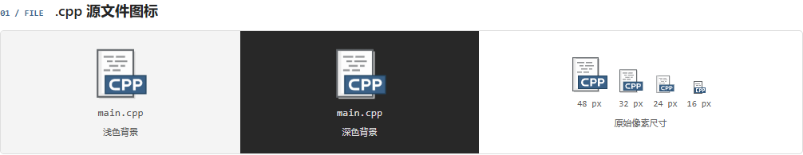
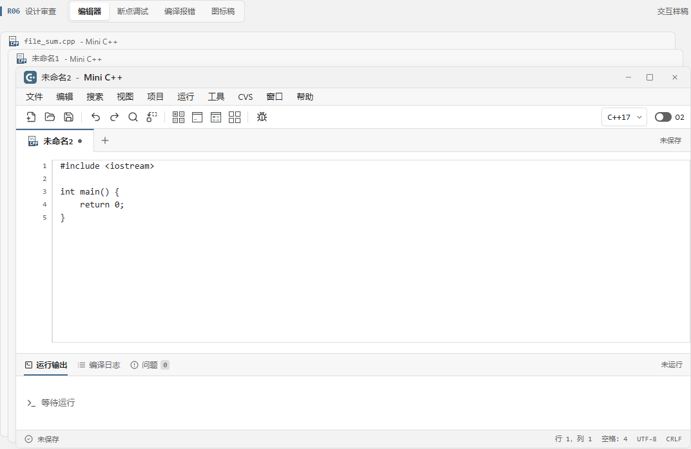
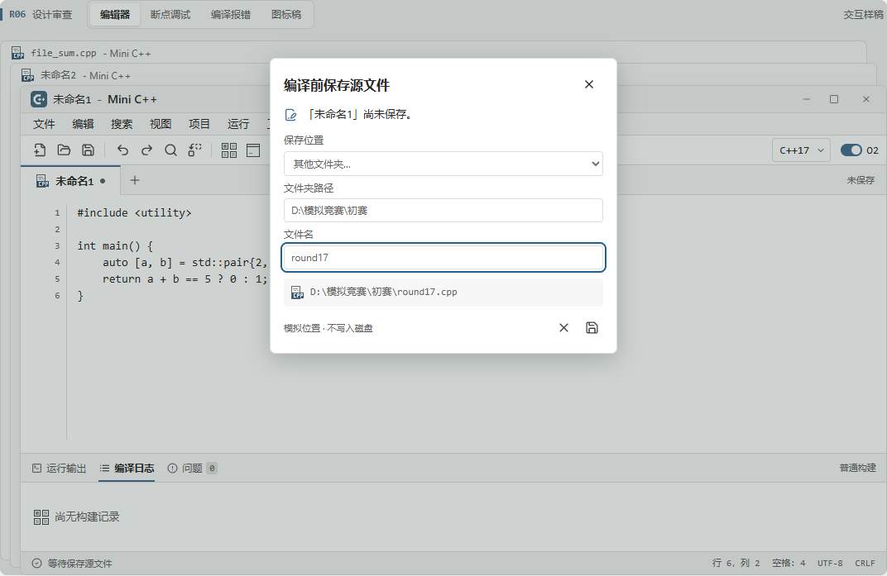
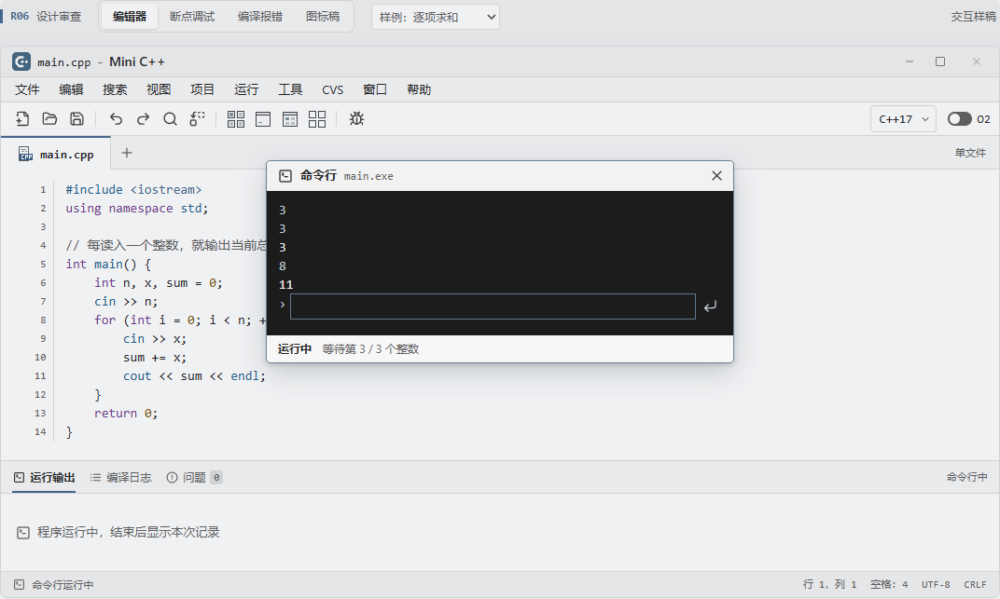

# Mini C++

面向 C++ 竞赛生的单源文件工作台。**R06 是界面和图标审查稿，不是可执行的 IDE。** 草稿、模拟保存位置和运行记录只保存在本次预览的内存中；不会启动系统终端、执行任意 C++ 或读写用户文件。设计确认后再接入真实工具链。

**[查看交互稿](design/review.html)**：将此文件下载到本机后用浏览器打开即可，支持离线使用。GitHub 文件页本身只展示源码。

### 灰白界面与源文件图标

标题栏、菜单、文件栏和状态栏使用浅灰，工具栏与代码区保留白底，常用工具图标是深灰色。原来的绿色点缀改为低饱和蓝，主要用于当前标签的细线、开启的 O2 开关和应用标记。暂停位置仍用琥珀色，断点和错误仍用红色。「视图 → 跟随系统外观」可切换为跟随系统。`.cpp` 文件用白色纸页和灰色代码短线表示，仅右下角的 `CPP` 角标着蓝色。

[源文件 SVG](design/icons/cpp-file.svg) · [源文件 Windows ICO](design/icons/cpp-file.ico) · [应用 Windows ICO](design/icons/mini-cpp.ico)。两枚 ICO 均含 16、24、32、48、64、128、256 像素帧；源文件图标的 16 像素版单独按像素绘制。稿内的 `main.cpp` 标签、打开文件及源文件属性共用这套图标。**未更改系统文件关联。**

### 顶部导航

窗口标题、菜单栏、图标工具栏各占一行。按 Dev-C++ 的顺序保留「文件、编辑、搜索、视图、项目、运行、工具、CVS、窗口、帮助」。新建直接进入源代码编辑；CVS 在未关联仓库时为禁用项。

四个构建图标保留参考图的轮廓和顺序，内部使用石墨灰、留白与少量蓝灰：**四个内嵌方块**为编译（F9），**带短光标的窗口**为运行已有程序（F10），**窗内四格**为编译并运行（F11），**空心四格**为全部重新编译（F12）。按钮等宽、无常驻文字，悬停或键盘聚焦才显示动作名和快捷键。

### 新建、保存与编译

点编辑区旁的 `+`、工具栏的「新建」或按 `Ctrl+N`，立即打开一个独立的编辑窗口并聚焦代码，不弹对话框、不分配磁盘路径。草稿按**当前打开的未命名窗口中最小的空闲正整数**命名，例如「未命名1」「未命名2」。保存或关闭某个草稿后，其编号可复用。可点击露出的窗口标题或打开「窗口」菜单切换；各窗口的内容、运行记录和编译设置互不覆盖。

第一次对未保存的源文件执行「编译」「编译并运行」或「全部重新编译」，先选择保存位置并填写 `.cpp` 文件名，再继续刚才的操作。可以选择列出的文件夹或输入其他绝对路径；取消、关闭或按 `Esc` 均保留草稿并中止该操作。已保存且内容未改的文件不重复弹窗。「运行」只使用已有产物，本身不触发编译。审查稿中的位置均为模拟位置，刷新预览将清空全部草稿和模拟保存记录。

标准下拉框可切换 **C++98、C++11、C++14、C++17**。例如在 C++17 下开启 O2，普通构建命令显示 `g++ -std=c++17 -O2`，调试构建使用 `-std=c++17 -g -O0`。内置样例可演示运行，自定义源码只预览编译命令，不把它报告为已真实编译。正式版需使用支持这四种标准的现代 GCC，不能直接沿用示例诊断所用的 GCC 4.7.2。

### 运行与回看

默认选中「逐项求和」。点窗内四格的图标，先输入 `3` 并回车，再分别输入 `3`、`8`、`-2`。命令行分别输出 `3`、`11`、`9`。输入不会预填，输出随实际提交的数据变化。也可选「求总和」观察只在最后输出一次的程序。

- **[正常结束](design/screens/run-record.png)**：命令行收到最后一行输出并退出后，「运行输出」才按发生顺序显示刚才的输入、输出，不必先关窗。编译失败不弹命令行；中途关窗不会生成成功记录。
- **[长输出](design/screens/long-output.png)**：命令行保留本次完整内容。底部记录超过 10 行时只显示前 3 行、`…` 和末行，并标明省略行数；单行超过 120 个字符也用省略号收尾。
- **[文件输入输出](design/screens/file-io.png)**：文件样例模拟从 `sum.in` 读、向 `sum.out` 写；正常退出后只提示「已完成文件输入输出」，不回显文件内容。

### 审查场景

- **[编辑器](design/screens/editor.png)**：切换标准和 O2，下次构建的日志反映设置。可从「文件」试新建源代码，从「搜索」试查找与全部替换，从「编辑」查看撤销、全选、换行继承缩进、Tab / Shift+Tab 整体缩进、Ctrl+Tab 自动缩进选区（全选即全文）。
- **[断点调试](design/screens/debug.png)**：使用「求总和」源文件，样例输入 `3` 和 `3 8 -2`，输出 `9`。红点是断点，箭头是下一条语句；侧栏与代码悬停共用同一份变量值。运行时显示最近采样，暂停时显示该位置的值，离开作用域的 `i` 不再列出。调试使用独立的 `-g -O0` 副本示意，不改变普通构建的 O2 选择。
- **[编译报错](design/screens/diagnostic.png)**：先保留 GCC 原文，再给中文建议。“漏写分号”示例中的报告位置 `11:5` 和建议插入点 `10:17` 可分别跳转；另一个样例提示检查 `10:16` 处误写的 `xx`。两个示例的行列号均按 GCC 4.7.2 核对；原文和位置可能随编译器版本而变化。
- **[图标稿](design/screens/icons.png)**：查看应用图标的浅色、深色背景和实际尺寸，以及四个构建动作的不同轮廓。原稿：[应用 SVG](design/icons/mini-cpp.svg) · [Windows ICO](design/icons/mini-cpp.ico) · [工具栏 SVG](design/icons/)。

### 设计文件

`design/src/` 是可编辑的设计源文件；`design/classic-glyphs.mjs` 为工具栏、菜单、图标稿及四个独立 SVG 提供同一组方格坐标。修改应用或文件图标的 SVG 后运行 `node design/export-icons.mjs` 生成透明 PNG 和多帧 ICO；`node design/build.mjs` 使用仓库内的资源生成离线审查稿。`node design/verify.mjs` 检查浏览器交互、各图标帧并生成截图。导出图标及浏览器检查需要 `playwright-core` 和 Chromium，可用 `CHROME_PATH` 指定浏览器路径。

应用标记为本次设计，四个构建图标按参考轮廓重新绘制。其他通用图标使用 Lucide 0.468.0，详见[第三方许可](design/vendor/LUCIDE-LICENSE.txt)。本项目未嵌入 Dev-C++ 的原始图标或代码。
