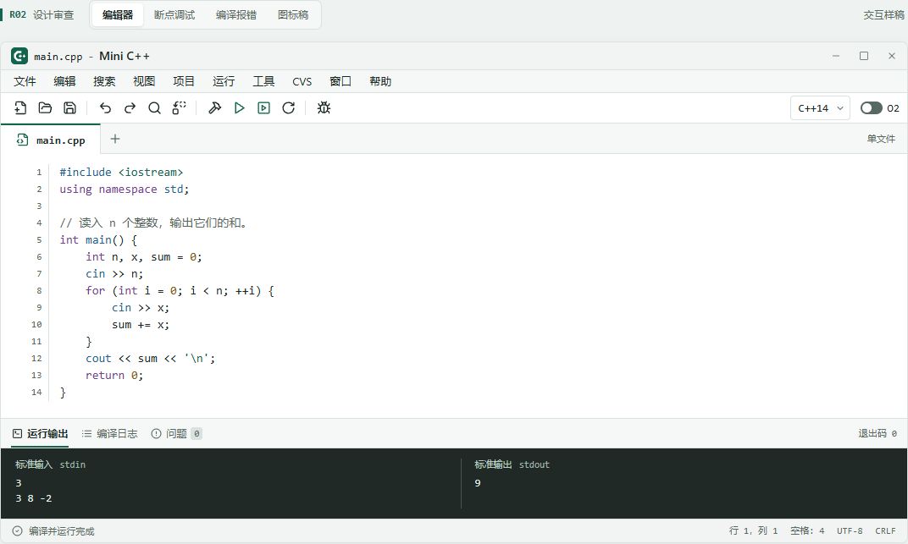
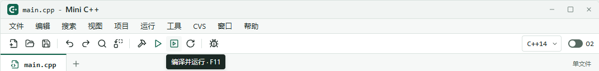

# Mini C++

面向 C++ 竞赛生的单源文件工作台。**当前版本 R02 是界面和图标审查稿，不是可执行的 IDE。** 编译、运行与调试交互使用同一组预置数据；没有接入工具链，也不会读写用户的源文件。设计确认后再开始正式开发。

**[查看交互稿](design/review.html)**：将此文件下载到本机后用浏览器打开即可，支持离线使用。GitHub 文件页本身只展示源码。

### 顶部导航

窗口标题、菜单栏、图标工具栏各占一行。按 Dev-C++ 的顺序保留「文件、编辑、搜索、视图、项目、运行、工具、CVS、窗口、帮助」。新建直接得到 `.cpp`，不弹项目向导；CVS 在未关联仓库时为禁用项。

四个构建按钮等宽、无常驻文字：锤子 **编译**（F9）、三角 **运行已有程序**（F10）、框内三角 **编译并运行**（F11）、环形箭头 **全部重新编译**（F12）。悬停或通过键盘聚焦才显示动作名及快捷键，不改变工具栏宽度。右侧只保留当前标准和 O2 开关。

### 审查场景

- **[编辑器](design/screens/editor.png)**：切换 C++98 / C++11 / C++14 及 O2；下次普通构建的日志反映设置。可从「文件」试新建源代码，从「搜索」试查找与全部替换，从「编辑」查看撤销、全选、换行继承缩进、Tab / Shift+Tab 整体缩进、Ctrl+Tab 自动缩进选区（全选即全文）。
- **[断点调试](design/screens/debug.png)**：同一份 `main.cpp`，样例输入 `3` 和 `3 8 -2`，输出 `9`。红点是断点，箭头是下一条语句；侧栏与代码悬停共用同一份变量值。运行时显示最近采样，暂停时显示该位置的值，离开作用域的 `i` 不再列出。调试方案使用独立的 `-g -O0` 副本，不修改普通构建的 O2 选择。
- **[编译报错](design/screens/diagnostic.png)**：先保留 GCC 原文，再给中文建议。“漏写分号”示例中的报告位置 `11:5` 和建议插入点 `10:17` 可分别跳转；另一个样例提示检查 `10:16` 处误写的 `xx`。两个示例的行列号均按 GCC 4.7.2 核对；原文和位置可能随编译器版本而变化。
- **[图标稿](design/screens/icons.png)**：查看应用图标的浅色、深色背景和实际尺寸，以及四个构建动作的不同轮廓。原稿：[应用 SVG](design/icons/mini-cpp.svg) · [Windows ICO](design/icons/mini-cpp.ico) · [工具栏 SVG](design/icons/)。

### 设计文件

`design/src/` 是可编辑的设计源文件；`node design/build.mjs` 可用仓库内的资源重新生成离线审查稿。`design/verify.mjs` 是浏览器交互与截图检查脚本，需要 `playwright-core` 和 Chromium，可用 `CHROME_PATH` 指定浏览器位置。

应用标记为本次设计。功能图标使用 Lucide 0.468.0，详见[第三方许可](design/vendor/LUCIDE-LICENSE.txt)。本项目未使用 Dev-C++ 的原始图标或代码。
